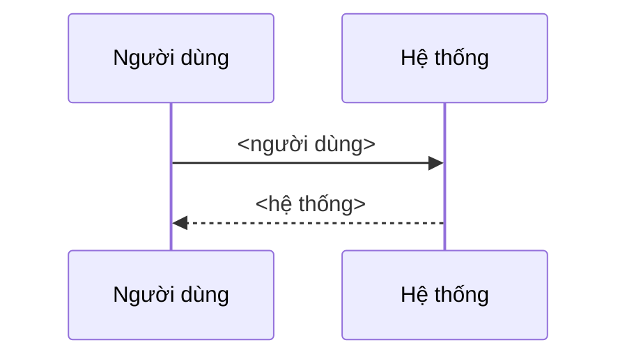

# Use case sequence diagram

Sơ đồ là một view. Bảng Các bước và các block Nhánh thay thế là nguồn. Đừng bao giờ đổi một block để làm sơ đồ khớp.

Làm theo các bước theo đúng thứ tự. Cùng một file phải luôn cho cùng kết quả. Trường hợp không được quy tắc phủ thì dừng và báo; đừng tự chọn.

## 1. Đọc

Đọc đúng file use case mục tiêu.

- Bước: dòng `| S<n> | ... |` trong bảng `## Các bước`. Giữ thứ tự file. Đọc cột Người dùng và cột Hệ thống (cột 2 và 3).
- Nhánh: heading `### A<n> · <tên>` dưới `## Nhánh thay thế`. Đọc `- **Tại:**` và `- **Kết thúc:**`.

Dừng và báo, không viết gì, khi: bảng thiếu cột; một dòng bước không có `S<n>`; một nhánh thiếu Tại hoặc Kết thúc; Tại gọi tên bước không tồn tại; có bước trùng; không có bước nào.

## 2. Xây message

1. Khai báo participant: `participant U as Người dùng` và `participant S as Hệ thống`.
2. Với mỗi bước theo thứ tự:
   - Cột Người dùng không trống → `U->>S: <người dùng>`.
   - Cột Hệ thống không trống → `S-->>U: <hệ thống>`.
   - Thay mọi `"` trong nội dung bằng `'`.
   - Thay mọi `;` trong nội dung bằng `,`. Mermaid coi `;` là dấu tách câu lệnh, nên nhãn chứa `;` làm sơ đồ không parse được.

## 3. Nhánh thay thế

Nhánh thay thế mang ngữ nghĩa quay lại/tiếp tục/sang use case khác nên không dẹt vào sequence. Ghi chúng ở dòng chú thích dưới sơ đồ, không vẽ: với mỗi nhánh, `<A<n>> (<Kết thúc>)`; nối bằng `, `; nếu không có nhánh ghi `không có`.

## 4. Viết khối

Khối đúng các dòng sau (mỗi dòng trong code block lùi 2 khoảng trắng):

````
<!-- BEGIN generated: use-case-sequence -->


*Không vẽ (nhánh thay thế): <danh sách>.*
<!-- END generated: use-case-sequence -->
````

## 5. Ghi file

- Đọc file trước. Dùng một Edit; `old_string` chạy từ dòng BEGIN tới dòng END (gồm cả hai); `new_string` là toàn bộ khối mới bắt đầu bằng dòng BEGIN.
- Nếu thiếu marker, chèn `## Sơ đồ tương tác`, một dòng trống, và khối ngay sau frontmatter, trước heading đầu tiên.
- Không đổi gì ngoài marker.

## 6. Khả chuyển

Theo "Portability defaults" trong [mermaid-markdown](../mermaid-markdown/SKILL.md). Người đọc dùng GitHub và VS Code 1.121 trở lên (Mermaid preview có sẵn).

## 7. Kiểm và báo cáo

- Mỗi bước thành đúng message. Mỗi nhánh được ghi trong dòng "Không vẽ".
- Nếu có `npx`, kiểm cú pháp bằng Mermaid CLI; nói đã chạy hay chưa.
- Báo: file, số message, danh sách nhánh, và các kiểm đã chạy.
