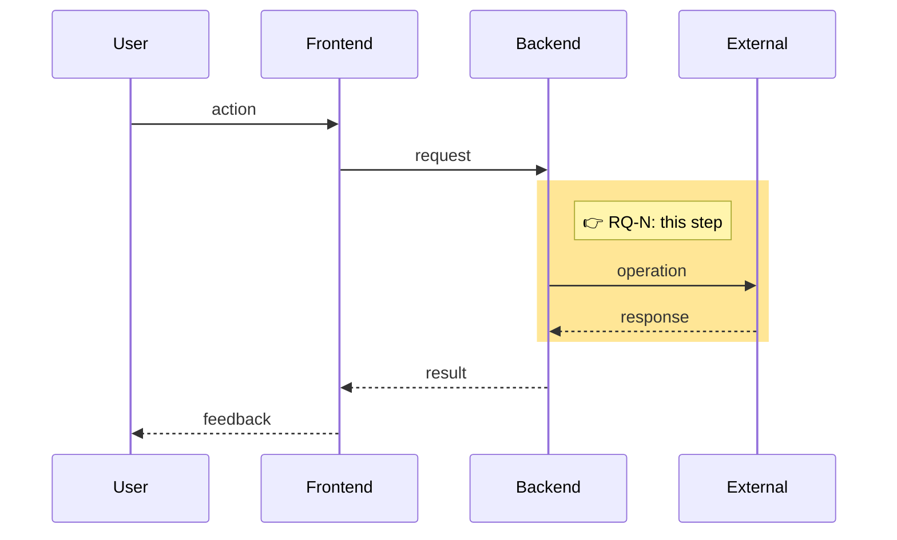

## Context

**Use case:** UC-XXX
**Related FR/NFR:** FR-NNN / NFR-NNN
**Flow step:** S?.? — {tên bước}
**Flow tracker:** #N

## Flow diagram

<!-- Mermaid sequence diagram showing the runtime flow of the UC.
     Highlight the step(s) this question relates to using `activate` / `note`.
     The reader should see WHERE in the flow this question comes from
     before reading the question itself. -->

<!-- Replace the diagram above with the actual flow for this UC.
     Use `rect rgb(255, 230, 150)` to highlight the step(s)
     this research question comes from. -->

## Question

<!-- The specific question to answer. One question per ticket. -->

## Why this matters

<!-- Which requirement or decision depends on this answer. Be specific. -->

## Options (if technical)

<!-- Fill this table when the question is a technology choice. Remove if not applicable. -->

| Option | Description | Fits requirements | Tradeoffs |
|---|---|---|---|
| Option A | | | |
| Option B | | | |
| Option C | | | |

## Deliverable

<!-- What closing this ticket produces. One of: -->
<!-- - Decision record: docs/decisions/DEC-NNN-topic.md -->
<!-- - Research answer: update to docs/research/topic.md, question Q-NNN -->

## Acceptance

- [ ] Question answered with evidence or reasoning
- [ ] Deliverable file created or updated
- [ ] Reviewed

## Blocked by

<!-- List prerequisite tickets. Remove if none. -->
