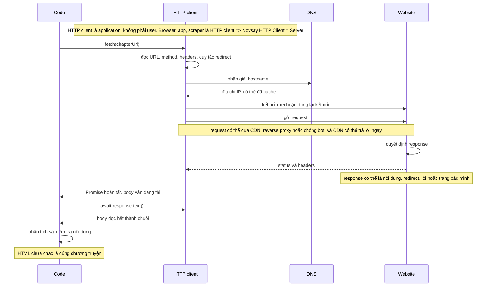
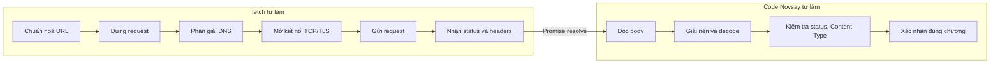
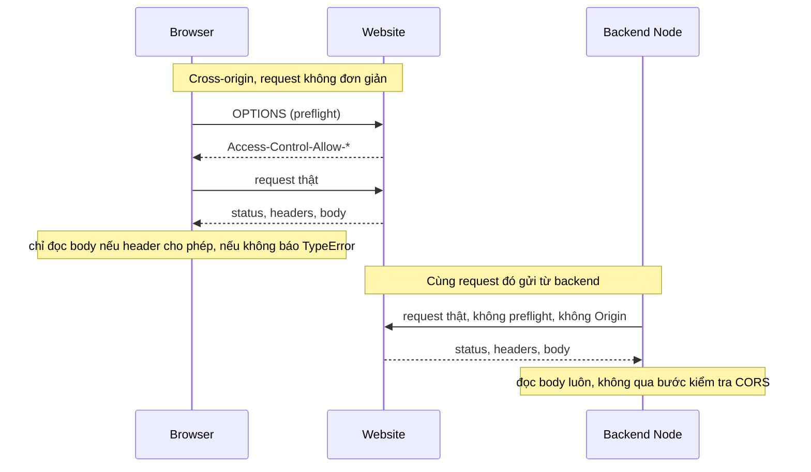
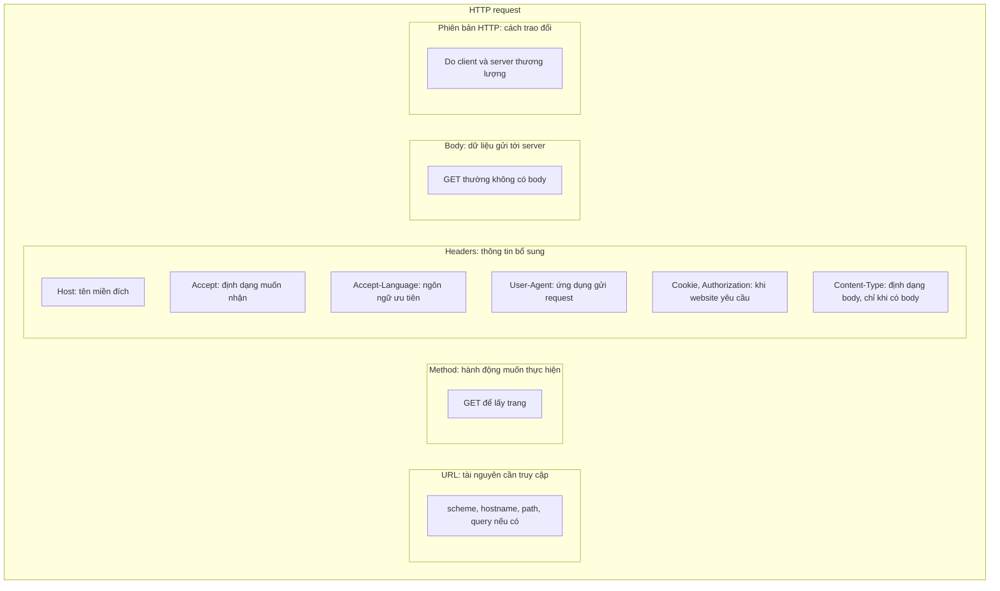
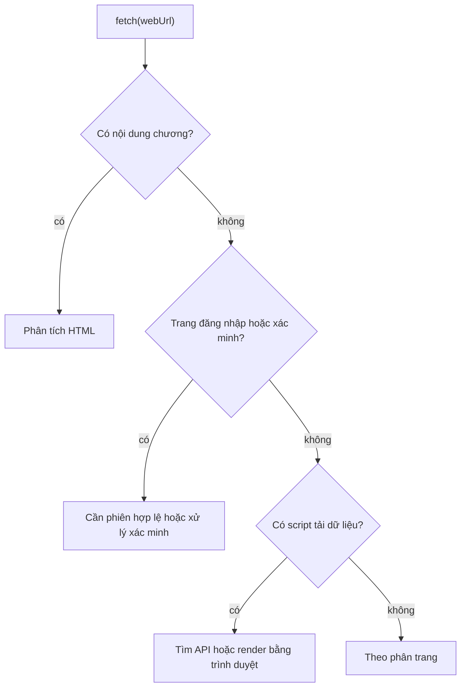
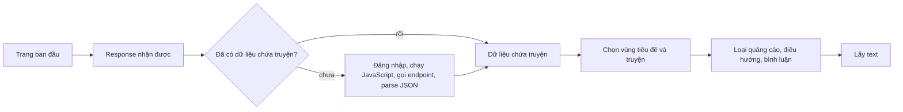
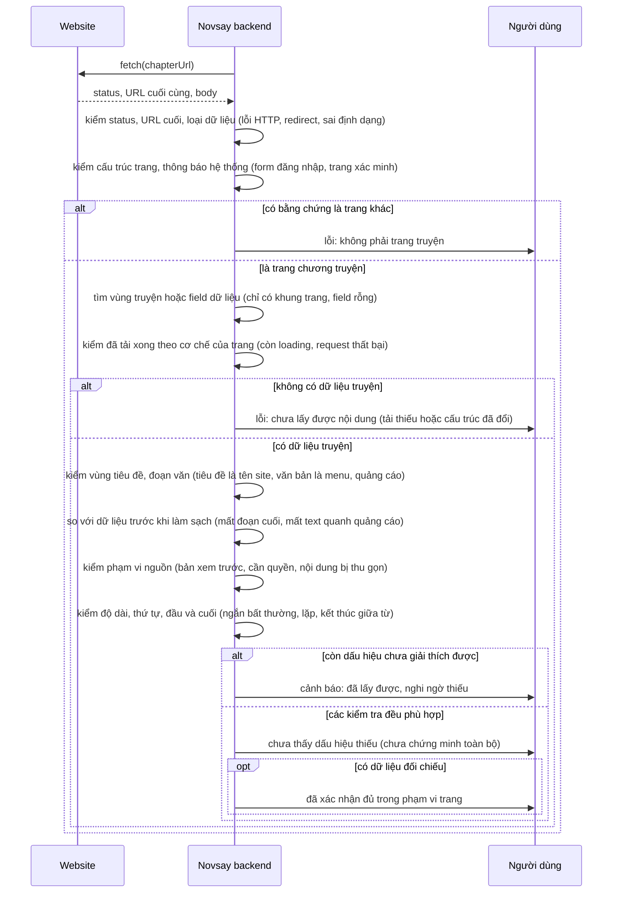

# Lấy nội dung website

## **Q-001:** Làm thế nào để lấy nội dung từ một website link?

> Luồng khi request đó đi từ một đoạn code tới khi nhận được response trở lại là gì?

Giả sử code chạy ở backend và gọi:

```js
const response = await fetch(chapterUrl);
```



---

> Bản chất `fetch(webUrl)` hoạt động như thế nào?

`fetch` không "mở trang web" và không render gì cả. Nó là HTTP client đóng gói thành API: nhận URL, dựng request, gửi qua mạng, rồi trả `Promise<Response>` . Promise đó chỉ đại diện cho **status và headers**, chưa phải nội dung đã đọc xong.



| # | Bước | Điều xảy ra | Điểm cần kiểm tra |
|---|---|---|---|
| 1 | Chuẩn hoá URL | tách `scheme` , `hostname` , `port` , `path` , `query` ; chỉ nhận `http` / `https` ; URL phải tuyệt đối | URL do người dùng nhập → chặn SSRF (Q-005) |
| 2 | Dựng request | `GET` mặc định; client tự sinh `Host` , `Accept` , `Accept-Encoding` , `User-Agent` , `Connection` ; `GET` không có body | server có chặn `User-Agent` lạ không |
| 3 | Phân giải DNS | hỏi resolver hoặc cache của OS, có thể trả nhiều bản ghi A/AAAA | IP có trỏ vào mạng nội bộ không |
| 4 | Mở kết nối | bắt tay TCP; nếu `https` thêm TLS (SNI, chứng chỉ, ALPN); hoặc dùng lại kết nối trong pool | lỗi TLS, chứng chỉ hết hạn |
| 5 | Gửi request | serialize thành byte (HTTP/1.1) hoặc frame (HTTP/2, HTTP/3) và ghi lên socket | proxy hoặc CDN chen giữa |
| 6 | Nhận status và headers | đọc dòng status cùng headers; `3xx` với `redirect: follow` thì lặp lại bước 1–5, tối đa khoảng 20 lần | redirect sang domain khác |
| 7 | Trả `Response` | resolve ngay khi headers tới, body vẫn đang tải dưới dạng stream | đừng tưởng body đã sẵn sàng |
| 8 | Đọc body | `text()` , `json()` hoặc `arrayBuffer()` kéo hết stream, giải nén, decode charset, trả kết nối về pool | body nén, `chunked` , sai charset |
| 9 | Kiểm tra kết quả | `fetch` chỉ reject khi lỗi mạng, TLS hoặc timeout; `403` , `404` , `500` vẫn resolve | `response.status` , `response.ok` , `Content-Type` |

Ba điểm dễ hiểu sai:

* `await fetch(...)` xong không có nghĩa là đã có body, vì promise resolve ngay khi headers tới.
* `4xx` và `5xx` không phải exception, nên phải tự kiểm tra `response.ok`.
* `fetch` không chạy JavaScript của trang, không có cookie jar và không có CORS — CORS là chuyện của browser, xem câu hỏi dưới.

---

> CORS là gì, vì sao browser có sẵn còn backend thì không, và khác biệt gì khi dùng `fetch(webUrl)` ?

CORS (Cross-Origin Resource Sharing) là cơ chế **trình duyệt thực thi**, không thuộc giao thức HTTP. Server chỉ khai báo chính sách bằng header, browser đọc chính sách rồi quyết định có cho JavaScript đọc response hay không. Origin là `scheme + host + port` , nên `https://novsay.com` gọi `https://novel543.com` là cross-origin. CQRS (Command Query Responsibility Segregation) là pattern kiến trúc khác, không liên quan.



| Header | Ý nghĩa |
|---|---|
| `Access-Control-Allow-Origin` | origin nào được đọc response |
| `Access-Control-Allow-Methods` | method nào được gọi |
| `Access-Control-Allow-Headers` | header tùy biến nào được gửi |
| `Access-Control-Allow-Credentials` | có cho gửi cookie hoặc `Authorization` không |
| `Access-Control-Max-Age` | cache kết quả preflight bao lâu |

**Vì sao browser có mà backend không:**

* Browser chạy code không tin cậy: JS do người khác viết, tải từ origin khác, nhưng vẫn mang cookie/session của người dùng. Không có Same-Origin Policy thì JS của `evil.com` đọc được dữ liệu của site khác, nên browser phải là bên thực thi.
* Backend không có gì để bảo vệ theo nghĩa đó: code do dev Novsay viết, không có origin (Node `fetch` không gửi `Origin`), không có cookie jar, không có session người dùng. Ai chạy được code trên server thì đã có quyền truy cập mạng,  `curl` cũng gọi được.
* Vì vậy CORS bảo vệ **người dùng**, không bảo vệ server. Backend không có gì để "bật", và phần phải tự lo là thứ khác: chống SSRF, giới hạn domain đích, tự quản cookie, tự đặt `User-Agent`.

Hệ quả khi gọi `fetch(webUrl)` từ backend:

| Khía cạnh | Browser | Backend Node |
|---|---|---|
| Preflight `OPTIONS` | có, nếu request không đơn giản | không bao giờ |
| `Origin` , `Referer` | tự gửi | không gửi, trừ khi tự thêm |
| Cookie | tự gửi và lưu; JS không đọc được `Set-Cookie` | không tự gửi, không tự lưu; đọc được `Set-Cookie` |
| Thiếu header CORS | lỗi `TypeError` , không thấy status | không ảnh hưởng, vẫn đọc body |
| `User-Agent` , `Sec-Fetch-*` | giống browser thật | là của server, dễ bị chống bot phát hiện |
| Rủi ro phải tự xử lý | không có | SSRF, DNS rebinding, redirect độc hại |

**Điểm cốt lõi:** backend đọc được nội dung từ site **không** cho phép CORS — điều browser không làm được — nhưng phải trả giá bằng việc tự xử lý cookie, rate limit, chặn theo IP và `User-Agent` , và chặn SSRF như ở Q-005.

---

> Nếu gửi request để fetch một trang web thông thì trong request đó sẽ có các thành phần nào?

Ví dụ request lấy chương truyện, viết theo HTTP/1.1:

```http
GET /book-id/chapter-id.html HTTP/1.1
Host: www.novel543.com
Accept: text/html
Accept-Language: zh-CN,zh;q=0.9
User-Agent: Novsay/0.1
```



HTTP client tự tạo phần lớn các thành phần này, nên code không phải viết tay cả request. `Cookie` và `Authorization` chỉ cần khi website yêu cầu. HTTP/2 và HTTP/3 biểu diễn request khác HTTP/1.1 nhưng vẫn giữ method, headers và body.

Cần phân biệt `Accept` và `Content-Type` : `Accept` cho biết client muốn nhận định dạng nào; `Content-Type` mô tả định dạng của body đang gửi hoặc nhận. Request `GET` thường không có body nên thường không cần `Content-Type` .

---

> Có phải website nào cũng fetch giống nhau?

Không. Mọi trang đều trao đổi theo cùng một giao thức HTTP: nhận request, trả status, headers và body. Khác là ở chỗ body chứa gì và phải đáp ứng điều kiện gì mới có body đó, nên cùng `fetch(webUrl)` có thể cho ra những thứ rất khác nhau.

| Trang | Request đầu trả về |
|---|---|
| Nội dung nằm sẵn trong HTML | HTML có chương |
| Nội dung do JavaScript tải | HTML chỉ là khung |
| Cần đăng nhập | trang đăng nhập hoặc lỗi xác thực |
| Có phân trang | một phần nội dung |
| Chống bot | trang xác minh |

Khác biệt nằm ở bốn thứ: **độ đầy đủ** (một phần hay cả chương), **đối tượng** (chương hay trang chặn), **định dạng** (HTML, khung rỗng hay JSON), và **tính ổn định** (cùng URL nhưng khác cookie, ngôn ngữ, IP hay thời điểm).



`fetch()` không chạy JavaScript, nên "browser thấy truyện" không đồng nghĩa "một lần fetch lấy được truyện".

---

> Website chặn bên thứ ba bằng cách nào, và cách nào có thể vượt qua?

Chưa xác minh Novel543 dùng cơ chế nào; dưới đây là các cơ chế chung. Phải xác định đúng nguyên nhân trước, vì một `403` riêng lẻ chưa đủ để kết luận.

| Tình huống | Biểu hiện | Có vượt được không, bằng cách nào |
|---|---|---|
| Đăng nhập, phân quyền | `401` , `403` , redirect tới trang đăng nhập | được, nếu website cho phép tích hợp: dùng phiên và cookie hợp lệ |
| Rate limiting | `429` , có thể kèm `Retry-After` | được: giảm tốc độ và request đồng thời, cache, chờ theo `Retry-After` |
| Chặn IP hoặc mạng | `403` , đóng kết nối, timeout | hạn chế: đổi nguồn nếu hợp lệ, retry có giới hạn |
| WAF, nhận diện bot | trang chặn hoặc trang xác minh, ví dụ [Cloudflare challenge](https://developers.cloudflare.com/cloudflare-challenges/challenge-types/challenge-pages/) | khó: cần người dùng xác minh hoặc nguồn được website cho phép |
| CAPTCHA, JavaScript challenge | nhận HTML xác minh thay cho nội dung | khó: browser automation không bảo đảm vượt |
| URL hoặc token có hạn | request cũ không còn hoạt động | được: lấy URL hoặc token mới từ trang chương |
| CORS | frontend không đọc được body | được: cho frontend gọi backend Novsay, backend fetch nguồn |
| Nội dung tải bằng JavaScript | HTML chỉ là khung | được: tìm API mà trang gọi, hoặc browser automation khi phù hợp |

Ba lỗi không phải chặn nhưng vẫn gặp: `5xx` tạm thời (retry có giới hạn, chờ tăng dần), chữ tiếng Trung lỗi (kiểm tra charset), HTML đổi cấu trúc (cập nhật parser sau khi kiểm tra HTML mới).

Hai điểm dễ nhầm:

* **CORS chỉ ràng buộc JavaScript trong browser.** Backend không chịu CORS nhưng vẫn chịu đăng nhập, rate limit và chống bot;  `mode: "no-cors"` chỉ trả response *opaque*, không đọc được body ([MDN: CORS](https://developer.mozilla.org/en-US/docs/Web/HTTP/Guides/CORS)).
* **`robots.txt` là hướng dẫn cho crawler, không phải khóa truy cập**, theo đúng Robots Exclusion Protocol.

**Đề xuất cho phiên bản đầu của Novsay:** fetch trực tiếp từ backend; nếu gặp xác minh hoặc từ chối truy cập thì trả lỗi rõ ràng.

---

## **Q-002:** Làm thế nào để tách tiêu đề và toàn bộ văn bản truyện khỏi quảng cáo, điều hướng và bình luận?

Đường đi luôn là: trang ban đầu → response nhận được → xử lý phần còn thiếu → **dữ liệu chứa truyện** → tách tiêu đề và văn bản. "Dữ liệu chứa truyện" là đã có nội dung, nhưng chưa tách riêng tiêu đề khỏi văn bản.



| Loại trang | Response ban đầu | Bước cần làm | Dữ liệu sau bước đó | Ảnh hưởng khi tách |
|---|---|---|---|---|
| Có truyện sẵn trong HTML | HTML đủ tiêu đề, truyện, quảng cáo, điều hướng, có thể cả bình luận | không cần tải thêm | HTML của trang | parse DOM, chọn vùng tiêu đề và truyện, loại node thừa |
| JavaScript tải truyện | HTML khung, chưa có truyện | chạy trong trình duyệt, đợi vùng truyện tải xong | DOM đã có nội dung | chọn từ DOM hiện tại; quảng cáo và bình luận có thể được tải thêm |
| JavaScript tải truyện, tìm được endpoint | HTML khung, truyện do request riêng tải | gọi endpoint với đúng quyền và tham số | thường là JSON, có thể là HTML fragment | JSON thì đọc field; fragment thì parse như HTML; đừng giả định cấu trúc giống cả trang |
| Truyện nhúng trong HTML dưới dạng JSON | HTML có khối JSON, vùng hiển thị có thể còn trống | tìm và parse khối JSON | object JSON | đọc field; nếu field chứa HTML thì parse thêm một bước |
| Yêu cầu đăng nhập | trang đăng nhập, redirect hoặc lỗi xác thực | đăng nhập hợp lệ rồi lấy lại trang | HTML đầy đủ, HTML khung hoặc JSON | đăng nhập chỉ mở quyền truy cập; cách tách phụ thuộc định dạng thực nhận |
| Yêu cầu xác minh chống bot | trang xác minh thay cho trang truyện | hoàn tất xác minh theo cách website cho phép rồi lấy lại nội dung | HTML đầy đủ, HTML khung hoặc JSON | xác minh không quyết định cách tách; kiểm tra dữ liệu cuối rồi chọn |

Sau khi đã có dữ liệu chứa truyện, còn ba chênh lệch phải kiểm tra:

| Chênh lệch | Ví dụ | Hệ quả |
|---|---|---|
| Khác định dạng | HTML chứa `<p>` so với JSON chứa mảng đoạn | dùng đúng HTML parser hoặc JSON parser |
| Khác cấu trúc và nội dung thừa | HTML gốc và DOM sau JavaScript có vùng truyện, quảng cáo, bình luận khác nhau | chọn selector và quy tắc loại nội dung thừa theo cấu trúc thực tế |
| Khác văn bản hoặc độ đầy đủ | một nguồn đủ truyện, nguồn khác chỉ là bản xem trước | phải tìm nguồn đầy đủ; đổi parser không khôi phục được phần chưa nhận |

Các bước có thể nối tiếp: đăng nhập → nhận HTML khung → chạy JavaScript → nhận DOM chứa truyện → tách tiêu đề và văn bản.

---

## **Q-003:** Làm thế nào để nhận biết nội dung lấy về bị thiếu hoặc không phải chương truyện?

Cần hai phép kiểm tra độc lập: **dữ liệu có đúng là chương truyện không**, và **văn bản trên trang đó đã đầy đủ chưa**. Status `200` , tiêu đề hợp lệ hay văn bản dài đều chưa đủ để kết luận. Việc kiểm tra diễn ra **cả trước và sau khi tách tiêu đề, văn bản**, vì nội dung có thể thiếu ngay từ nguồn hoặc bị mất trong bước trích xuất.

Các bước kiểm tra chạy **bên trong backend Novsay**, không phải một service riêng. Sơ đồ dưới chỉ tách `Website` , `Novsay backend` và `Người dùng` để thấy ai làm gì.



Mỗi bước là một dòng `kiểm tra gì (dấu hiệu có vấn đề)` ; điều kiện rẽ nhánh nằm ở nhãn `alt` / `else` .

**Dấu hiệu phải dựa vào cấu trúc và ngữ cảnh:** thấy chữ "đăng nhập" trong văn bản không đủ để kết luận đó là trang đăng nhập — chữ này có thể nằm trong lời truyện.

Ba nguyên nhân thiếu cần phân biệt vì cách sửa khác nhau:

| Nguyên nhân | Ví dụ | Cách xác minh |
|---|---|---|
| Nguồn chưa trả đủ | response chỉ chứa bản xem trước | kiểm tra thông báo và dữ liệu nguồn thực sự cung cấp |
| Nội dung chưa tải xong | HTML khung đã nhận, truyện chưa được JavaScript bổ sung | kiểm tra trạng thái tải và dữ liệu bổ sung |
| Trích xuất làm mất nội dung | quy tắc xóa quảng cáo xóa luôn đoạn truyện bên cạnh | so sánh kết quả với HTML, JSON hoặc DOM trước khi làm sạch |

Các tín hiệu ở bước cuối **chỉ là cảnh báo**, không phải bằng chứng: một chương có thể ngắn thật, tác giả có thể không kết thúc bằng dấu câu, và trang lỗi vẫn có thể giữ tiêu đề "Chương…".

**"Không thấy dấu hiệu thiếu" khác với "đã chứng minh đầy đủ".** Muốn khẳng định đầy đủ cần một căn cứ như đối chiếu toàn bộ vùng truyện đã tải xong, hoặc metadata về số phần mà nguồn cam kết cung cấp.

---

## **Q-004**: Làm thế nào để giữ đúng ký tự, dấu câu và thứ tự đoạn khi lấy và trích xuất nội dung đa ngôn ngữ?

> Response Data nhận được tồn tại dưới dạng gì trước khi ta thấy được HTML hay là JSON? 

Khi fetch một trang web, bạn nhận dữ liệu dưới dạng bytes. Với nội dung văn bản, các bytes cần được giải mã theo đúng encoding, chẳng hạn UTF-8, để trở thành chuỗi ký tự Unicode. Sau đó, chương trình phân tích HTML hoặc JSON, lấy phần văn bản cần thiết và chuẩn hóa nó. Mỗi bước đều có thể làm lỗi ký tự, thay đổi dấu câu hoặc mất ranh giới đoạn nếu xử lý sai.

Flow để nghiên cứu là: **Bytes nhận được → giải mã theo encoding → phân tích HTML/JSON → trích xuất văn bản → chuẩn hóa → kiểm tra kết quả.**

---

> **Decision (22/10/26): Không nghiên cứu sâu phần này, cái này để Coding Agents xử lí.**

## **Q-005:** Làm thế nào để ngăn link hoặc chuyển hướng truy cập vào mạng riêng của server?

Cái này liên quan đến một lỗi nổi tiếng là Server-Side Request Forgery Prevention Cheat Sheet.
