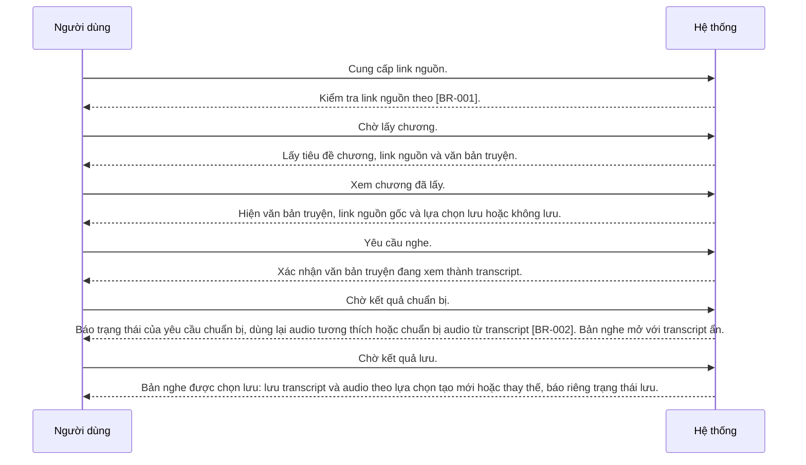

---
id: UC-001
title: "Người dùng chuẩn bị một chương web để nghe"
updated: 21-10-2026
---

## Sơ đồ tương tác

<!-- Sinh tự động từ bảng Các bước và Nhánh thay thế. Không sửa giữa hai marker. -->

<!-- BEGIN generated: use-case-sequence -->

*Không vẽ (nhánh thay thế): A1 (Cùng bước), A2 (Kết thúc), A3 (Cùng bước), A4 (Kết thúc), A7 (Cùng bước), A6 (Cùng bước), A8 (Cùng bước), A9 (Tiếp tại S2), A10 (Cùng bước), A11 (Cùng bước), A12 (Kết thúc).*
<!-- END generated: use-case-sequence -->

## Các bước

| Bước | Người dùng | Hệ thống | FR | Bằng chứng |
|---|---|---|---|---|
| S1 | Cung cấp link nguồn. | Kiểm tra link nguồn theo [BR-001]. | FR-001 | [assumed] |
| S2 | Chờ lấy chương. | Lấy tiêu đề chương, link nguồn và văn bản truyện. | FR-002 | [assumed] |
| S3 | Xem chương đã lấy. | Hiện văn bản truyện, link nguồn gốc và lựa chọn lưu hoặc không lưu. | FR-003, FR-008 | [assumed] |
| S4 | Yêu cầu nghe. | Xác nhận văn bản truyện đang xem thành transcript. | FR-003 | [inferred: quyết định owner, 21-10-2026] |
| S5 | Chờ kết quả chuẩn bị. | Báo trạng thái của yêu cầu chuẩn bị; dùng lại audio tương thích hoặc chuẩn bị audio từ transcript [BR-002]. Bản nghe mở với transcript ẩn. | FR-004, FR-008, FR-010 | [assumed] |
| S6 | Chờ kết quả lưu. | Bản nghe được chọn lưu: lưu transcript và audio theo lựa chọn tạo mới hoặc thay thế; báo riêng trạng thái lưu. | FR-006, FR-008, FR-013 | [inferred: quyết định owner, 21-10-2026] |

## Nhánh thay thế

### A1 · Link nguồn không hợp lệ

- **Tại:** S1
- **Kết thúc:** Cùng bước
- **Khi:** Link nguồn vi phạm quy tắc nguồn [BR-001].
- **Hệ thống:** Từ chối link nguồn và nêu lý do.
- **FR:** FR-001

### A2 · Đích không an toàn

- **Tại:** S1, S2
- **Kết thúc:** Kết thúc
- **Khi:** Link nguồn hoặc chuyển hướng trỏ tới mạng riêng hoặc dịch vụ cục bộ.
- **Hệ thống:** Từ chối đích và nêu lý do.
- **FR:** FR-001

### A3 · Lấy nội dung thất bại

- **Tại:** S2
- **Kết thúc:** Cùng bước
- **Khi:** Không tới được website nguồn hoặc không lấy được văn bản truyện.
- **Hệ thống:**
  - Báo lấy chương thất bại.
  - Giữ link nguồn và cho người dùng thử lấy lại.
- **FR:** FR-002, FR-007

### A4 · Văn bản truyện sai

- **Tại:** S3
- **Kết thúc:** Kết thúc
- **Khi:** Người dùng báo văn bản truyện đã lấy bị sai.
- **Hệ thống:**
  - Báo văn bản truyện đã lấy bị sai.
  - Kết thúc chuẩn bị mà không tạo audio.
- **FR:** FR-003

### A7 · Chưa chọn lưu hay không lưu

- **Tại:** S4
- **Kết thúc:** Cùng bước
- **Khi:** Owner yêu cầu nghe mà chưa chọn lưu hay không lưu.
- **Hệ thống:**
  - Yêu cầu owner chọn lưu hoặc không lưu.
  - Chưa bắt đầu chuẩn bị audio.
- **FR:** FR-003, FR-008

### A6 · Chuẩn bị audio thất bại

- **Tại:** S5
- **Kết thúc:** Cùng bước
- **Khi:** Chuẩn bị audio thất bại.
- **Hệ thống:**
  - Báo chuẩn bị audio thất bại.
  - Giữ transcript đã xác nhận, lựa chọn lưu và chương.
  - Cho owner thử lại.
- **FR:** FR-007

### A8 · Lưu bản nghe thất bại

- **Tại:** S6
- **Kết thúc:** Cùng bước
- **Khi:** Lưu transcript hoặc audio của bản nghe thất bại.
- **Hệ thống:**
  - Báo bản nghe chưa hoàn tất.
  - Giữ audio còn phát được.
  - Cho owner yêu cầu thử lưu lại.
  - Thử lưu lại chỉ lưu phần còn thiếu.
  - Khi thay thế, giữ bản cũ còn nguyên tới khi lưu mới hoàn tất.
- **FR:** FR-008, FR-013

### A9 · Link nguồn trùng bản đã lưu

- **Tại:** S1
- **Kết thúc:** Tiếp tại S2
- **Khi:** Link nguồn hợp lệ trùng bản đã lưu trong tài khoản owner.
- **Hệ thống:**
  - Yêu cầu owner chọn tạo bản mới hoặc thay thế một bản đã lưu.
  - Nhiều bản trùng thì owner chọn bản đích.
- **FR:** FR-013

### A10 · Quay lại yêu cầu đã chọn lưu

- **Tại:** S5
- **Kết thúc:** Cùng bước
- **Khi:** Owner đã chọn lưu, quay lại app trên cùng thiết bị và tìm yêu cầu chuẩn bị trước đó.
- **Hệ thống:**
  - Báo trạng thái thực của yêu cầu: đang chuẩn bị, đã sẵn sàng hoặc đã thất bại/gián đoạn.
  - Xác định đúng chương và transcript của yêu cầu đó.
  - Không tạo yêu cầu chuẩn bị mới.
- **FR:** FR-012

### A11 · Chưa chọn tạo mới hay thay thế khi lưu

- **Tại:** S6
- **Kết thúc:** Cùng bước
- **Khi:** Trước khi ghi bản lưu, hệ thống phát hiện bản đã lưu cùng link nguồn mà owner chưa chọn tạo mới hay thay thế.
- **Hệ thống:**
  - Yêu cầu owner chọn tạo bản mới hoặc thay thế một bản đã lưu.
  - Tiếp tục cùng yêu cầu lưu sau khi owner chọn.
- **FR:** FR-013

### A12 · Chọn không lưu khi audio đã sẵn sàng

- **Tại:** S5
- **Kết thúc:** Kết thúc
- **Khi:** Owner chọn không lưu và audio đã sẵn sàng.
- **Hệ thống:**
  - Cung cấp bản nghe cho phiên hiện tại.
  - Không tạo hoặc thay thế bản đã lưu.
- **FR:** FR-008, FR-013

## Tình huống và mục tiêu

Người đọc đã tìm thấy một chương và muốn nghe văn bản truyện của nó.

## Kích hoạt và tiền điều kiện

- **Kích hoạt:** Người dùng cung cấp link nguồn.
- **Tiền điều kiện:** Owner đã đăng nhập. Owner có link nguồn muốn dùng.

## Kết quả và đảm bảo tối thiểu

- **Kết quả:** Audio của chương phát được trong phiên hiện tại. Bản đã lưu hoàn tất khi owner chọn lưu và việc lưu thành công. Trạng thái chuẩn bị audio và trạng thái lưu được báo riêng.
- **Đảm bảo tối thiểu:** Chuẩn bị hoặc lưu thất bại giữ nguyên link nguồn, transcript đã xác nhận và mọi kết quả còn dùng được. Bản đã lưu cũ chưa bị thay khi thao tác thay thế chưa hoàn tất.

## Bằng chứng sản phẩm

### ElevenReader

- **Bao phủ:** chưa kiểm chứng
- **Thẻ nghiên cứu:** elevenreader-reference.md
- **Khác biệt:** Chưa so sánh runtime. Tài liệu tham khảo không chọn flow nào.

## Ghi chú

Owner xem văn bản truyện trước khi nghe; hành động nghe xác nhận văn bản đó thành transcript. Không có bước xác nhận riêng.
Bản đã lưu chỉ báo hoàn tất khi cả transcript và audio đều được lưu. Audio phát được không chứng minh bản đã lưu hoàn tất.
Owner chọn link chương công khai từ website nguồn được phép [BR-001]. Không chọn luồng sửa hay thay văn bản.
Tiền điều kiện tài khoản do UC-004 cung cấp. Người dùng chưa đăng nhập gửi link nguồn thì UC-004 cấp tài khoản trước S1; không gọi đăng nhập lại sau đó.
A5 đã loại bỏ; chính sách quota tạo audio không thuộc scope hiện tại.
Khi bản nghe mới được mở để nghe, transcript mặc định ẩn theo FR-010. Văn bản xem trước ở S3 vẫn được hiện như hiện tại.
Thay thế thành công reset tiến độ của bản đích theo FR-006.
Kết thúc ở A12 chỉ là kết thúc chuẩn bị, không phải đóng phiên hoặc xóa dữ liệu tạm. Owner vẫn nghe và yêu cầu lưu sau đó theo UC-002.
Nếu như link truyện là truyện tiếng Trung, Novsay đọc nguyên bản tiếng Trung; việc chuyển sang dịch tiếng Việt là một featrue để version sau.
