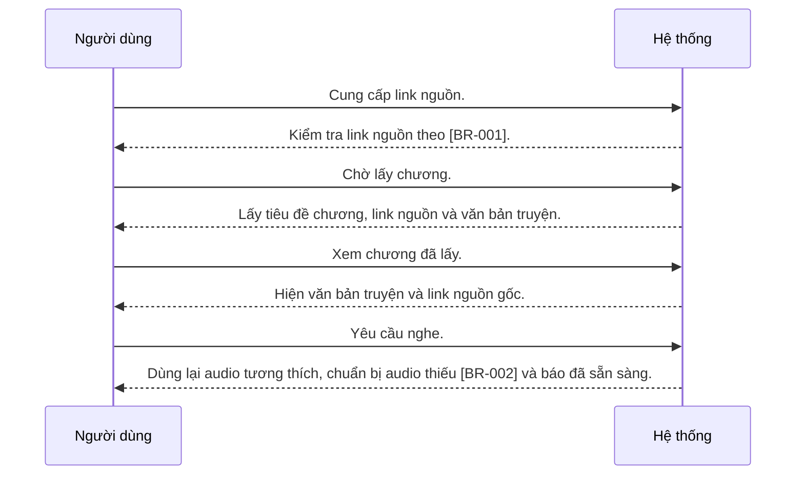

---
id: UC-001
title: "Người dùng chuẩn bị một chương web để nghe"
updated: 21-10-2026
---

## Sơ đồ tương tác

<!-- Sinh tự động từ bảng Các bước và Nhánh thay thế. Không sửa giữa hai marker. -->

<!-- BEGIN generated: use-case-sequence -->

*Không vẽ (nhánh thay thế): A1 (Cùng bước), A2 (Kết thúc), A3 (Cùng bước), A4 (Kết thúc), A6 (Cùng bước).*
<!-- END generated: use-case-sequence -->

## Các bước

| Bước | Người dùng | Hệ thống | FR | Bằng chứng |
|---|---|---|---|---|
| S1 | Cung cấp link nguồn. | Kiểm tra link nguồn theo [BR-001]. | FR-001 | [assumed] |
| S2 | Chờ lấy chương. | Lấy tiêu đề chương, link nguồn và văn bản truyện. | FR-002 | [assumed] |
| S3 | Xem chương đã lấy. | Hiện văn bản truyện và link nguồn gốc. | FR-003 | [assumed] |
| S4 | Yêu cầu nghe. | Dùng lại audio tương thích, chuẩn bị audio thiếu [BR-002] và báo đã sẵn sàng. | FR-004, FR-008 | [inferred: quyết định owner, 21-10-2026] |

## Nhánh thay thế

### A1 · Link nguồn không hợp lệ

- **Tại:** S1
- **Kết thúc:** Cùng bước
- **Khi:** Link nguồn vi phạm quy tắc nguồn [BR-001].
- **Hệ thống:** Từ chối link nguồn và nêu lý do.
- **FR:** FR-001

### A2 · Đích không an toàn

- **Tại:** S1, S2
- **Kết thúc:** Kết thúc
- **Khi:** Link nguồn hoặc chuyển hướng trỏ tới mạng riêng hoặc dịch vụ cục bộ.
- **Hệ thống:** Từ chối đích và nêu lý do.
- **FR:** FR-001

### A3 · Lấy nội dung thất bại

- **Tại:** S2
- **Kết thúc:** Cùng bước
- **Khi:** Không tới được website nguồn hoặc không lấy được văn bản truyện.
- **Hệ thống:**
  - Báo lấy chương thất bại.
  - Giữ link nguồn và cho người dùng thử lấy lại.
- **FR:** FR-002, FR-007

### A4 · Văn bản truyện sai

- **Tại:** S3
- **Kết thúc:** Kết thúc
- **Khi:** Người dùng báo văn bản truyện đã lấy bị sai.
- **Hệ thống:**
  - Báo nội dung đã lấy bị sai.
  - Kết thúc chuẩn bị mà không tạo audio.
- **FR:** FR-003

### A6 · Chuẩn bị audio thất bại

- **Tại:** S4
- **Kết thúc:** Cùng bước
- **Khi:** Chuẩn bị audio thất bại.
- **Hệ thống:**
  - Báo việc thất bại.
  - Giữ chương và cho người dùng thử chuẩn bị lại.
- **FR:** FR-007

## Tình huống và mục tiêu

Người đọc đã tìm thấy một chương và muốn nghe văn bản truyện của nó.

## Kích hoạt và tiền điều kiện

- **Kích hoạt:** Người dùng cung cấp link nguồn.
- **Tiền điều kiện:** Owner đã đăng nhập. Owner có link nguồn muốn dùng.

## Kết quả và đảm bảo tối thiểu

- **Kết quả:** Chương được xác định và audio phát được sẵn sàng.
- **Đảm bảo tối thiểu:** Chuẩn bị thất bại giữ nguyên link nguồn và mọi văn bản chương dùng được.

## Bằng chứng sản phẩm

### ElevenReader

- **Bao phủ:** chưa kiểm chứng
- **Thẻ nghiên cứu:** elevenreader-reference.md
- **Khác biệt:** Chưa so sánh runtime. Tài liệu tham khảo không chọn flow nào.

## Ghi chú

Owner chọn link chương công khai từ Novel543. Không chọn luồng sửa hay thay văn bản.
Tiền điều kiện tài khoản do UC-004 cung cấp. Người dùng chưa đăng nhập gửi link nguồn thì UC-004 cấp tài khoản trước S1; không gọi đăng nhập lại sau đó.
A5 đã loại bỏ; chính sách quota tạo audio không thuộc scope hiện tại.
Nếu như link truyện là truyện tiếng Trung, Novsay đọc nguyên bản tiếng Trung; việc chuyển sang dịch tiếng Việt là một featrue để version sau.
