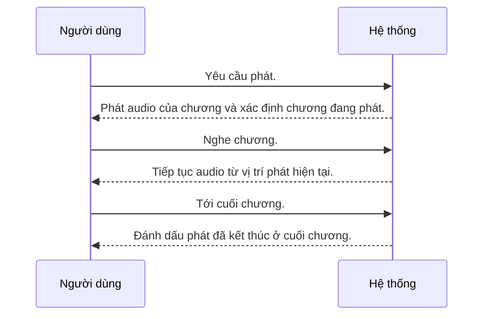

---
id: UC-002
title: "Người dùng nghe một chương đã chuẩn bị"
updated: 21-10-2026
---

## Sơ đồ tương tác

<!-- Sinh tự động từ bảng Các bước và Nhánh thay thế. Không sửa giữa hai marker. -->

<!-- BEGIN generated: use-case-sequence -->

*Không vẽ (nhánh thay thế): A1 (Quay lại S2), A4 (Cùng bước), A6 (Kết thúc), A7 (Cùng bước).*
<!-- END generated: use-case-sequence -->

## Các bước

| Bước | Người dùng | Hệ thống | FR | Bằng chứng |
|---|---|---|---|---|
| S1 | Yêu cầu phát. | Phát audio của chương và xác định chương đang phát. | FR-005 | [assumed] |
| S2 | Nghe chương. | Tiếp tục audio từ vị trí phát hiện tại. | FR-005 | [assumed] |
| S3 | Tới cuối chương. | Đánh dấu phát đã kết thúc ở cuối chương. | FR-005 | [assumed] |

## Nhánh thay thế

### A1 · Tạm dừng và tiếp tục

- **Tại:** S2
- **Kết thúc:** Quay lại S2
- **Khi:** Người dùng tạm dừng rồi yêu cầu phát.
- **Hệ thống:**
  - Tạm dừng và lưu **tiến độ** nghe.
  - Tiếp tục từ vị trí tạm dừng khi người dùng yêu cầu.
- **FR:** FR-005, FR-006

### A4 · Phát thất bại

- **Tại:** S1, S2
- **Kết thúc:** Cùng bước
- **Khi:** Phát thất bại hoặc không có audio phát được.
- **Hệ thống:**
  - Báo không phát được.
  - Giữ tiến độ đã lưu và cho người dùng yêu cầu phát lại.
- **FR:** FR-005, FR-007

### A6 · Rời khỏi việc nghe

- **Tại:** S2
- **Kết thúc:** Kết thúc
- **Khi:** Người dùng kết thúc phiên nghe.
- **Hệ thống:**
  - Dừng phát.
  - Lưu tiến độ nghe.
- **FR:** FR-005, FR-006

### A7 · Nghe nền

- **Tại:** S2
- **Kết thúc:** Cùng bước
- **Khi:** Thiết bị ngừng hiện app.
- **Hệ thống:** Tiếp tục audio sẵn sàng trong môi trường đã thống nhất [NFR-001].
- **FR:** FR-005

## Tình huống và mục tiêu

Người đọc muốn nghe một chương.

## Kích hoạt và tiền điều kiện

- **Kích hoạt:** Người dùng yêu cầu phát.
- **Tiền điều kiện:** Owner đã đăng nhập. Chương đã có audio sẵn sàng. Môi trường đích định nghĩa ở [NFR-001].

## Kết quả và đảm bảo tối thiểu

- **Kết quả:** Người dùng đã nghe chương hoặc tới một vị trí phát tự chọn.
- **Đảm bảo tối thiểu:** Tiến độ đã lưu vẫn còn sau khi phát thất bại.

## Bằng chứng sản phẩm

### ElevenReader

- **Bao phủ:** chưa kiểm chứng
- **Thẻ nghiên cứu:** elevenreader-reference.md
- **Khác biệt:** Chưa so sánh runtime. Tài liệu tham khảo không chọn flow nào.

## Ghi chú

A2, A3, A5 đã loại bỏ; tốc độ phát, tua thủ công và tự chuyển chương kế không thuộc scope hiện tại.
Khôi phục tiến độ theo [NFR-003] qua yêu cầu chức năng của nó.
Nghe nền là bắt buộc nhưng chưa thử trên cả hai môi trường đích.
Tiền điều kiện tài khoản do UC-004 cung cấp.
