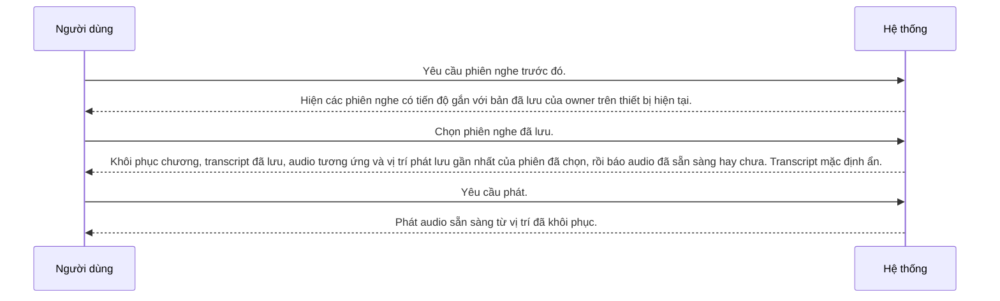

---
id: UC-003
title: "Người dùng tiếp tục một phiên nghe trước đó"
updated: 21-10-2026
---

## Sơ đồ tương tác

<!-- Sinh tự động từ bảng Các bước và Nhánh thay thế. Không sửa giữa hai marker. -->

<!-- BEGIN generated: use-case-sequence -->

*Không vẽ (nhánh thay thế): A1 (Kết thúc), A2 (Cùng bước), A3 (Cùng bước), A5 (Cùng bước).*
<!-- END generated: use-case-sequence -->

## Các bước

| Bước | Người dùng | Hệ thống | FR | Bằng chứng |
|---|---|---|---|---|
| S1 | Yêu cầu phiên nghe trước đó. | Hiện các phiên nghe có tiến độ gắn với bản đã lưu của owner trên thiết bị hiện tại. | FR-006 | [assumed] |
| S2 | Chọn phiên nghe đã lưu. | Khôi phục chương, transcript đã lưu, audio tương ứng và vị trí phát lưu gần nhất của phiên đã chọn, rồi báo audio đã sẵn sàng hay chưa. Transcript mặc định ẩn. | FR-006, FR-008, FR-010 | [assumed] |
| S3 | Yêu cầu phát. | Phát audio sẵn sàng từ vị trí đã khôi phục. | FR-005 | [assumed] |

## Nhánh thay thế

### A1 · Không có phiên có tiến độ

- **Tại:** S1
- **Kết thúc:** Kết thúc
- **Khi:** Không có phiên nghe có tiến độ nào cho owner trên thiết bị hiện tại.
- **Hệ thống:**
  - Báo không có phiên nghe có tiến độ.
  - Không tự tạo chương hay vị trí phát.
- **FR:** FR-006

### A2 · Audio không sẵn sàng

- **Tại:** S2
- **Kết thúc:** Cùng bước
- **Khi:** Chương đã lưu có transcript đã lưu nhưng không có audio tương thích sẵn sàng.
- **Hệ thống:**
  - Báo audio chưa sẵn sàng.
  - Giữ transcript đã lưu và tiến độ cũ.
  - Chỉ chuẩn bị lại audio từ transcript đã lưu sau yêu cầu của owner.
  - Thành công thì đặt tiến độ về đầu, báo lý do và chờ owner yêu cầu phát.
  - Thất bại thì giữ tiến độ cũ; chỉ thử lại sau yêu cầu của owner.
  - Không lấy lại nguồn để thay transcript.
- **FR:** FR-004, FR-006, FR-008

### A3 · Khôi phục thất bại

- **Tại:** S2
- **Kết thúc:** Cùng bước
- **Khi:** Không khôi phục được chương đã lưu, transcript đã lưu không còn dùng được, hoặc chuẩn bị audio của nó thất bại.
- **Hệ thống:**
  - Báo việc nào thất bại và cho người dùng thử lại.
  - Không thay transcript đã lưu bằng văn bản truyện lấy lại từ nguồn.
  - Giữ tiến độ nghe đã lưu.
- **FR:** FR-007, FR-008

### A5 · Phát từ vị trí đã lưu thất bại

- **Tại:** S3
- **Kết thúc:** Cùng bước
- **Khi:** Phát từ vị trí đã lưu thất bại.
- **Hệ thống:**
  - Báo phát thất bại và cho người dùng yêu cầu phát lại.
  - Giữ tiến độ nghe đã lưu.
- **FR:** FR-007

## Tình huống và mục tiêu

Người đọc quay lại và muốn tiếp tục từ vị trí đã lưu.

## Kích hoạt và tiền điều kiện

- **Kích hoạt:** Người dùng yêu cầu phiên nghe trước đó.
- **Tiền điều kiện:** Owner đã đăng nhập và yêu cầu phiên nghe trên cùng thiết bị.

## Kết quả và đảm bảo tối thiểu

- **Kết quả:** Người dùng nghe chương đã lưu từ vị trí phát lưu gần nhất.
- **Đảm bảo tối thiểu:** Khôi phục thất bại không ghi đè tiến độ đã lưu.

## Bằng chứng sản phẩm

### ElevenReader

- **Bao phủ:** chưa kiểm chứng
- **Thẻ nghiên cứu:** elevenreader-reference.md
- **Khác biệt:** Chưa so sánh runtime. Tài liệu tham khảo không chọn flow nào.

## Ghi chú

A4 đã loại bỏ; chính sách quota cho người dùng công cộng không thuộc scope hiện tại.
Danh sách chỉ gồm phiên nghe có tiến độ gắn với bản đã lưu của owner trên thiết bị hiện tại.
Không có phiên có tiến độ không đồng nghĩa không có bản đã lưu. Owner mở bản đã lưu qua UC-006, kể cả bản chưa từng nghe.
Nhiều bản cùng link nguồn không được gộp thành một tiến độ.
Mất transcript đã lưu là lỗi; bản nghe không được thay bằng văn bản truyện lấy lại từ nguồn.
Khôi phục phiên không tự hiện transcript. Owner yêu cầu hiện theo FR-010.
Khôi phục cùng audio theo [NFR-003]. Tạo lại audio reset tiến độ theo FR-006.
Không tự áp tiến độ cũ sau khi thay thế bản nghe hoặc tạo lại audio.
Chọn phiên không tự bắt đầu tạo lại audio. Owner yêu cầu tạo lại khi cần.
Tiền điều kiện tài khoản do UC-004 cung cấp. Dùng tài khoản không chọn đồng bộ tiến độ nhiều thiết bị.
