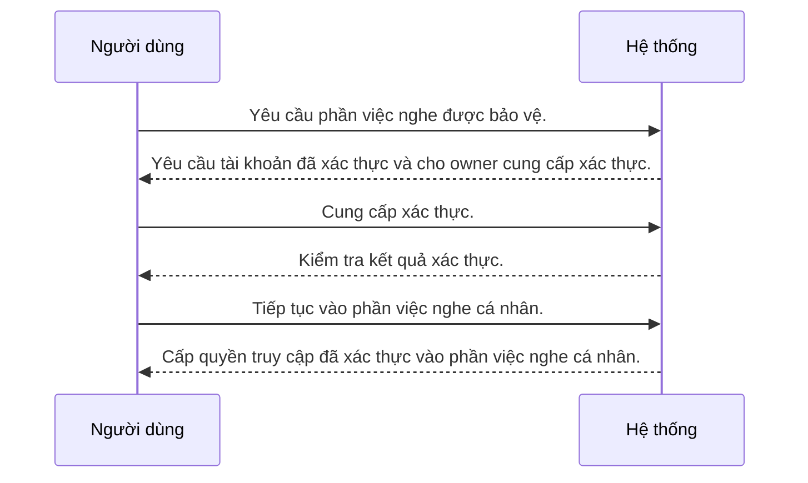

---
id: UC-004
title: "Owner đăng nhập vào app được host"
updated: 21-10-2026
---

## Sơ đồ tương tác

<!-- Sinh tự động từ bảng Các bước và Nhánh thay thế. Không sửa giữa hai marker. -->

<!-- BEGIN generated: use-case-sequence -->

*Không vẽ (nhánh thay thế): A1 (Cùng bước), A2 (Kết thúc), A3 (Quay lại S1).*
<!-- END generated: use-case-sequence -->

## Các bước

| Bước | Người dùng | Hệ thống | FR | Bằng chứng |
|---|---|---|---|---|
| S1 | Yêu cầu phần việc nghe được bảo vệ. | Yêu cầu tài khoản đã xác thực và cho owner cung cấp xác thực. | FR-009 | [inferred: quyết định owner, 21-10-2026] |
| S2 | Cung cấp xác thực. | Kiểm tra kết quả xác thực. | FR-009 | [inferred: quyết định owner, 21-10-2026] |
| S3 | Tiếp tục vào phần việc nghe cá nhân. | Cấp quyền truy cập đã xác thực vào phần việc nghe cá nhân. | FR-009 | [inferred: quyết định owner, 21-10-2026] |

## Nhánh thay thế

### A1 · Xác thực thất bại

- **Tại:** S2
- **Kết thúc:** Cùng bước
- **Khi:** Xác thực thất bại hoặc dịch vụ của nó không tới được.
- **Hệ thống:**
  - Báo xác thực thất bại.
  - Giữ phần việc được bảo vệ không truy cập được và cho owner thử lại.
- **FR:** FR-009

### A2 · Đăng xuất

- **Tại:** S3
- **Kết thúc:** Kết thúc
- **Khi:** Owner yêu cầu đăng xuất.
- **Hệ thống:**
  - Kết thúc quyền truy cập đã xác thực.
  - Giữ phần việc nghe đã lưu theo trạng thái hiện có.
- **FR:** FR-009

### A3 · Quyền truy cập hết hạn

- **Tại:** S3
- **Kết thúc:** Quay lại S1
- **Khi:** Phiên đã xác thực hết hiệu lực.
- **Hệ thống:**
  - Yêu cầu đăng nhập trước khi làm việc được bảo vệ tiếp.
  - Giữ tiến độ nghe đã lưu.
- **FR:** FR-009, FR-006

## Tình huống và mục tiêu

Owner muốn vào phần việc nghe cá nhân từ app được host.

## Kích hoạt và tiền điều kiện

- **Kích hoạt:** Owner yêu cầu phần việc nghe được bảo vệ.
- **Tiền điều kiện:** App được host tới được qua Internet.

## Kết quả và đảm bảo tối thiểu

- **Kết quả:** Owner có quyền truy cập đã xác thực vào phần việc nghe cá nhân.
- **Đảm bảo tối thiểu:** Xác thực thất bại không cấp quyền truy cập được bảo vệ.

## Ghi chú

Cách đăng nhập và cơ chế cấp tài khoản là lựa chọn triển khai cần khảo sát.
Không chọn đăng ký công cộng hay đồng bộ nhiều thiết bị.
Audio cục bộ có sẵn là riêng tư với owner đã xác thực; tài khoản khác không được truy cập.
