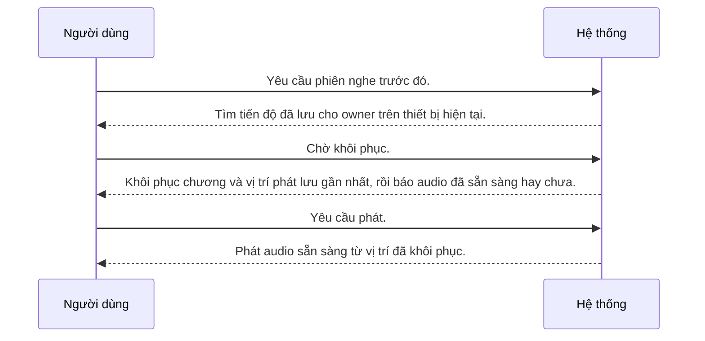

---
id: UC-004
title: "Người dùng tiếp tục một phiên nghe trước đó"
updated: 21-10-2026
---

## Sơ đồ tương tác

<!-- Sinh tự động từ bảng Các bước và Nhánh thay thế. Không sửa giữa hai marker. -->

<!-- BEGIN generated: use-case-sequence -->

*Không vẽ (nhánh thay thế): A1 (Kết thúc), A2 (Cùng bước), A3 (Cùng bước), A5 (Cùng bước).*
<!-- END generated: use-case-sequence -->

## Các bước

| Bước | Người dùng | Hệ thống | FR | Bằng chứng |
|---|---|---|---|---|
| S1 | Yêu cầu phiên nghe trước đó. | Tìm tiến độ đã lưu cho owner trên thiết bị hiện tại. | FR-006 | [assumed] |
| S2 | Chờ khôi phục. | Khôi phục chương và vị trí phát lưu gần nhất, rồi báo audio đã sẵn sàng hay chưa. | FR-006 | [assumed] |
| S3 | Yêu cầu phát. | Phát audio sẵn sàng từ vị trí đã khôi phục. | FR-005 | [assumed] |

## Nhánh thay thế

### A1 · Không còn tiến độ

- **Tại:** S1
- **Kết thúc:** Kết thúc
- **Khi:** Không còn tiến độ đã lưu cho phiên nghe được yêu cầu.
- **Hệ thống:**
  - Báo không có tiến độ đã lưu.
  - Không tự tạo chương hay vị trí phát.
- **FR:** FR-006

### A2 · Audio không sẵn sàng

- **Tại:** S2
- **Kết thúc:** Cùng bước
- **Khi:** Chương đã lưu có văn bản truyện nhưng không có audio tương thích sẵn sàng.
- **Hệ thống:**
  - Chuẩn bị audio thiếu bằng giọng đọc đã chọn [BR-002].
  - Giữ chương đã lưu và tiến độ nghe.
- **FR:** FR-004, FR-006, FR-008

### A3 · Khôi phục thất bại

- **Tại:** S2
- **Kết thúc:** Cùng bước
- **Khi:** Không khôi phục được chương đã lưu hoặc chuẩn bị audio của nó thất bại.
- **Hệ thống:**
  - Báo việc nào thất bại và cho người dùng thử lại.
  - Giữ tiến độ nghe đã lưu.
- **FR:** FR-007

### A5 · Phát từ vị trí đã lưu thất bại

- **Tại:** S3
- **Kết thúc:** Cùng bước
- **Khi:** Phát từ vị trí đã lưu thất bại.
- **Hệ thống:**
  - Báo phát thất bại và cho người dùng yêu cầu phát lại.
  - Giữ tiến độ nghe đã lưu.
- **FR:** FR-007

## Tình huống và mục tiêu

Người đọc quay lại và muốn tiếp tục từ vị trí đã lưu.

## Kích hoạt và tiền điều kiện

- **Kích hoạt:** Người dùng yêu cầu phiên nghe trước đó.
- **Tiền điều kiện:** Owner đã đăng nhập và yêu cầu phiên nghe trên cùng thiết bị.

## Kết quả và đảm bảo tối thiểu

- **Kết quả:** Người dùng nghe chương đã lưu từ vị trí phát lưu gần nhất.
- **Đảm bảo tối thiểu:** Khôi phục thất bại không ghi đè tiến độ đã lưu.

## Bằng chứng sản phẩm

### ElevenReader

- **Bao phủ:** chưa kiểm chứng
- **Thẻ nghiên cứu:** elevenreader-reference.md
- **Khác biệt:** Chưa so sánh runtime. Tài liệu tham khảo không chọn flow nào.

## Câu hỏi mở

- Vị trí nghe được ánh xạ thế nào sau khi audio tạo lại? Ảnh hưởng: S2, A2.
- Khôi phục được gì khi cả văn bản truyện cục bộ lẫn nội dung nguồn đều không còn? Ảnh hưởng: S2, A3.

## Ghi chú

A4 đã loại bỏ; chính sách quota cho người dùng công cộng không thuộc scope hiện tại.
Owner yêu cầu khôi phục trong [NFR-003]; việc tạo lại audio có thể cần ánh xạ vị trí nội dung riêng.
Tiền điều kiện tài khoản do UC-005 cung cấp. Dùng tài khoản không chọn đồng bộ nhiều thiết bị.
