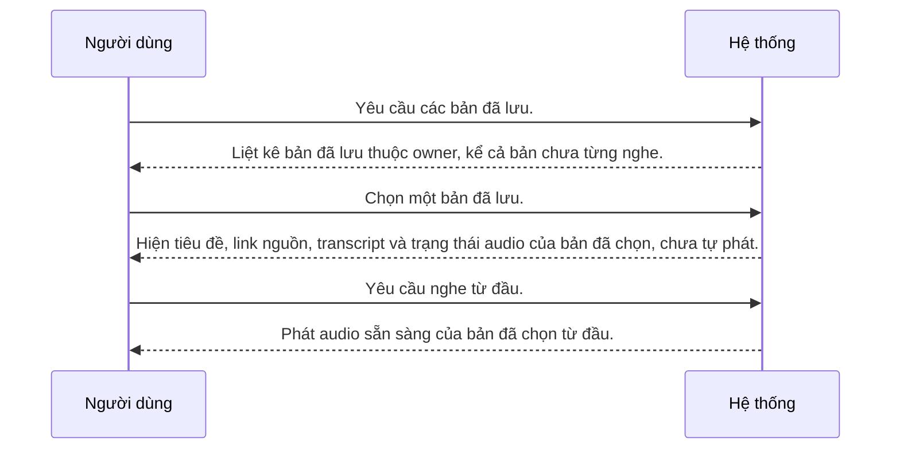

## Sơ đồ tương tác

<!-- Sinh tự động từ bảng Các bước và Nhánh thay thế. Không sửa giữa hai marker. -->

<!-- BEGIN generated: use-case-sequence -->

*Không vẽ (nhánh thay thế): A1 (Kết thúc), A2 (Sang UC-003), A3 (Cùng bước), A4 (Cùng bước), A5 (Kết thúc).*
<!-- END generated: use-case-sequence -->

## Các bước

| Bước | Người dùng | Hệ thống | FR | Bằng chứng |
|---|---|---|---|---|
| S1 | Yêu cầu các bản đã lưu. | Liệt kê bản đã lưu thuộc owner, kể cả bản chưa từng nghe. | FR-011 | [assumed] |
| S2 | Chọn một bản đã lưu. | Hiện tiêu đề, link nguồn, transcript và trạng thái audio của bản đã chọn, chưa tự phát. | FR-011, FR-008 | [assumed] |
| S3 | Yêu cầu nghe từ đầu. | Phát audio sẵn sàng của bản đã chọn từ đầu. | FR-005, FR-006 | [assumed] |

## Nhánh thay thế

### A1 · Danh sách trống

- **Tại:** S1
- **Kết thúc:** Kết thúc
- **Khi:** Không có bản đã lưu nào cho owner.
- **Hệ thống:** Báo chưa có bản đã lưu.
- **FR:** FR-011

### A2 · Tiếp tục từ tiến độ

- **Tại:** S2
- **Kết thúc:** Sang UC-003
- **Khi:** Bản đã chọn có tiến độ hợp lệ trên thiết bị hiện tại và owner yêu cầu tiếp tục.
- **Hệ thống:** Chuyển sang tiếp tục phiên nghe trước đó.
- **FR:** FR-006

### A3 · Nguồn không truy cập được

- **Tại:** S2
- **Kết thúc:** Cùng bước
- **Khi:** Nguồn của bản đã lưu không truy cập được nhưng transcript và audio đã lưu còn dùng được.
- **Hệ thống:** Vẫn mở bản đã lưu bằng dữ liệu đã lưu.
- **FR:** FR-008, FR-011

### A4 · Audio thiếu hoặc không dùng được

- **Tại:** S2
- **Kết thúc:** Cùng bước
- **Khi:** Audio của bản đã lưu thiếu hoặc không dùng được nhưng transcript còn dùng được.
- **Hệ thống:**
  - Báo audio chưa sẵn sàng.
  - Chỉ chuẩn bị lại audio khi owner yêu cầu.
- **FR:** FR-004, FR-007, FR-008

### A5 · Transcript không dùng được

- **Tại:** S2
- **Kết thúc:** Kết thúc
- **Khi:** Transcript của bản đã lưu không dùng được.
- **Hệ thống:**
  - Báo lỗi.
  - Giữ kết quả còn dùng được.
  - Không tự thay transcript bằng văn bản truyện lấy lại từ nguồn.
- **FR:** FR-007, FR-011

## Tình huống và mục tiêu

Owner muốn mở một bản đã lưu để xem transcript, trạng thái audio và nghe từ đầu, kể cả khi bản đó chưa từng nghe.

## Kích hoạt và tiền điều kiện

- **Kích hoạt:** Owner yêu cầu các bản đã lưu.
- **Tiền điều kiện:** Owner đã đăng nhập.

## Kết quả và đảm bảo tối thiểu

- **Kết quả:** Owner mở được bản đã lưu và nghe được audio sẵn sàng từ đầu.
- **Đảm bảo tối thiểu:** Transcript hoặc audio không dùng được thì không mất dữ liệu đã lưu còn dùng được; bản đã lưu không bị thay bằng văn bản truyện lấy lại từ nguồn.

## Bằng chứng sản phẩm

### ElevenReader

- **Bao phủ:** chưa kiểm chứng
- **Thẻ nghiên cứu:** elevenreader-reference.md
- **Khác biệt:** Chưa so sánh runtime. Tài liệu tham khảo không chọn flow nào.

## Ghi chú

Mở bản đã lưu không tự bắt đầu phát. Bản chưa có tiến độ vẫn mở được và nghe được từ đầu.
Không thêm đăng ký, tìm kiếm, sắp xếp, phân trang hoặc đồng bộ tiến độ nhiều thiết bị.
Tiền điều kiện tài khoản do UC-004 cung cấp.
