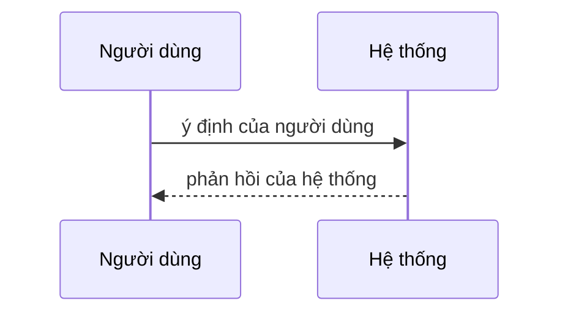

<!-- Use case mô hình hoá hành vi sản phẩm cho một mục tiêu người dùng đạt trong một lần ngồi (UCG-01).
     Viết theo docs/spec/_STYLE.md. Viết ý định và phản hồi, không viết giao diện (quy tắc 11, UCG-09).
     Sơ đồ tương tác là view sinh từ bảng Các bước và Nhánh thay thế; đừng sửa nó bằng tay (MG-02). -->

## Sơ đồ tương tác

<!-- Sinh tự động từ bảng Các bước và Nhánh thay thế. Không sửa giữa hai marker. -->

<!-- BEGIN generated: use-case-sequence -->

<!-- END generated: use-case-sequence -->

## Các bước

<!-- Bảng này là nguồn chân lý; sơ đồ trên được sinh từ nó. Mỗi dòng một bước S1, S2, ... theo thứ tự.
     Người dùng: ý định ("Chọn một truyện"), không phải thao tác trên điều khiển.
     Hệ thống: điều người dùng quan sát được; không "nếu", không cài đặt, không giao diện. Trích dẫn giá trị bằng [BR-xxx]/[NFR-xxx]; chưa viết: [BR-?: chủ đề].
     FR: ID yêu cầu chức năng cho phản hồi này, hoặc FR-? khi chưa có FR. Một phản hồi có thể có nhiều FR. Để trống khi bước không cần FR riêng.
     Bằng chứng: thẻ trong _STYLE.md, chỉ khi bước khẳng định điều gì về sản phẩm. Để trống nếu không. -->

| Bước | Người dùng | Hệ thống | FR | Bằng chứng |
|---|---|---|---|---|
| S1 |  |  | FR-? |  |

## Nhánh thay thế

<!-- Một block mỗi nhánh. ID ổn định, không đánh lại số (UCG-06).
     Tại: bước nhánh bắt đầu, ví dụ "S3". Kết thúc: một trong:
       Quay lại Sx / Tiếp tại Sx / Cùng bước / Kết thúc / Sang UC-xxx / Sang UC-? (chủ đề)
     Khi: điều kiện hệ thống phát hiện được, hoặc ý định người dùng (UCG-04).
     Trường cố định theo thứ tự: Tại, Kết thúc, Khi, Hệ thống, FR. -->

### A1 · Tên nhánh

- **Tại:** S?
- **Kết thúc:** Quay lại S?
- **Khi:**
- **Hệ thống:**
- **FR:** FR-?

## Tình huống và mục tiêu

<!-- Ai muốn gì, và vì sao lúc này, bằng lời người dùng. Không tính năng hay giải pháp (UCG-02). -->

## Kích hoạt và tiền điều kiện

<!-- Kích hoạt: điều gì khởi đầu case. Tiền điều kiện: điều gì đã đúng. Cả hai quan sát được, không cài đặt, không giao diện. -->

- **Kích hoạt:**
- **Tiền điều kiện:**

## Kết quả và đảm bảo tối thiểu

<!-- Kết quả: điều đúng sau thành công, kiểm chứng được bằng quan sát. Đảm bảo tối thiểu: điều vẫn đúng sau khi nhánh bất kỳ thất bại (UCG-05). -->

- **Kết quả:**
- **Đảm bảo tối thiểu:**

## Bằng chứng sản phẩm

<!-- Chỉ mức bao phủ: quan sát | không có | chưa kiểm chứng. Quan sát thô nằm ở docs/research/ (UCG-08).
     Khác biệt mô tả bằng lời, không giá trị quy tắc. Thêm một block cho mỗi sản phẩm tham chiếu. -->

### Tên sản phẩm

- **Bao phủ:** chưa kiểm chứng
- **Thẻ nghiên cứu:**
- **Khác biệt:**

## Câu hỏi mở

<!-- Mỗi câu hỏi có "?". Bỏ phần này nếu trống. -->

## Ghi chú

<!-- Vì sao case này không trùng case khác; lựa chọn thiết kế thành đề xuất ADR. Bỏ nếu trống. -->
