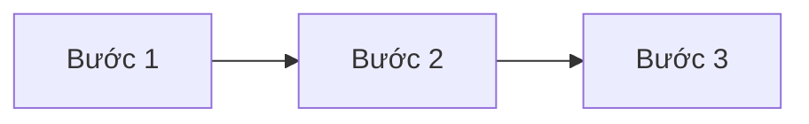

# Kế hoạch implementation — {scope}

## Phạm vi

- **Use case:** UC-XXX
- **Các bước:** S1-S2 (hoặc "tất cả")
- **Nhánh thay thế:** A1, A3 (hoặc "tất cả")
- **FR liên quan:** FR-NNN, FR-NNN
- **Quyết định cần:** DEC-NNN, DEC-NNN

## Điều kiện bắt đầu

- [ ] Tất cả ticket nghiên cứu trong phạm vi đã đóng (Phase 1 gate)
- [ ] Tất cả ticket test stub trong phạm vi đã đóng (Phase 2 gate)

## Các bước

### Bước 1 — Tên

- **Làm gì:** module, hàm, file path cần tạo hoặc sửa
- **Test cần pass:** #N (AC test), #N (unit test)
- **Dựa trên quyết định:** DEC-NNN
- **Dựa trên bước:** không
- **Ticket:** #N

### Bước 2 — Tên

- **Làm gì:**
- **Test cần pass:** #N
- **Dựa trên quyết định:** DEC-NNN
- **Dựa trên bước:** Bước 1
- **Ticket:** #N

## Sơ đồ phụ thuộc

## Phê duyệt

- [ ] Đã review
- [ ] Đã chấp nhận — tiến hành tạo ticket
